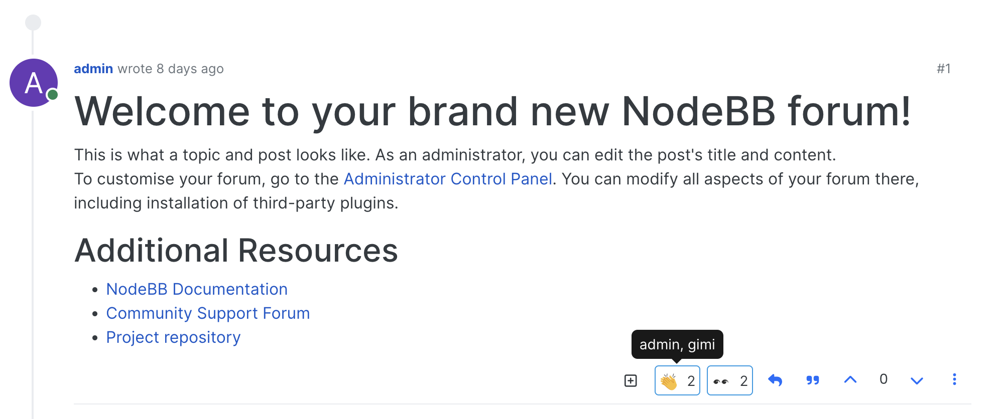
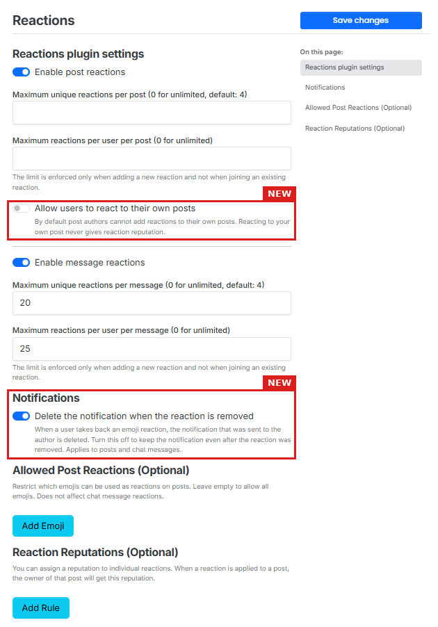
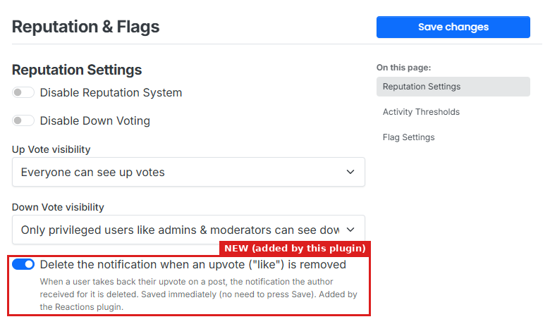

# nodebb-plugin-reactions

Emoji reactions for NodeBB posts and chat messages.

This is a fork of [ClickAndGoScript/nodebb-plugin-reactions](https://github.com/ClickAndGoScript/nodebb-plugin-reactions) (MIT). It contains everything from the original plugin plus the changes listed under [What's different from the original](#whats-different-from-the-original).

This plugin requires `nodebb-plugin-emoji` to be active.

## Installation

    npm i git+https://github.com/hershaleh/nodebb-plugin-reactions

Then activate the plugin in the Admin Control Panel (Extend > Plugins), and run **Rebuild & Restart**.

The package keeps the original name (`@clickandgo/nodebb-plugin-reactions`), so it can replace the original plugin in place. If you install it manually, it must live in `node_modules/@clickandgo/nodebb-plugin-reactions`.

## Screenshots

### Reactions

### Plugin settings (ACP > Plugins > Reactions)

Red frames mark what this fork adds.

### Built-in upvote switch (ACP > Settings > Reputation & Flags)

Red frame marks what this fork adds.

## What's different from the original

- **No self-reactions.** Post authors can't react to their own posts. This can be turned off in the plugin settings ("Allow users to react to their own posts"). A reaction on your own post never gives reaction reputation and never sends a notification.
- **Reactors on touch devices.** There is no hover on Android/iOS, so a long press on a reaction opens a popup that lists who reacted (styled like the desktop tooltip). The popup stays open until you tap somewhere else, so it survives the browser's "image options" dialog.
- **Full list of reactors.** Right-click (desktop) on a reaction, or "Show everyone" in the touch popup, opens the complete list of users.
- **Merged notifications, per emoji.** Several users reacting with the *same* emoji to the same post or chat message are merged into one notification ("A and 3 others reacted with 😄 to your post"). Different emojis on the same post keep separate notifications.
- **Emoji images in notifications.** Reaction notifications show the emoji as an image instead of the `:name:` text (also for older notifications and merged ones).
- **Notification is deleted when a reaction is removed.** When a user takes back their emoji reaction, the notification sent to the author is deleted. Switch: *Plugin settings > Notifications > "Delete the notification when the reaction is removed"* (applies to posts and chats, on by default).
- **Notification is deleted when a built-in upvote is removed.** This is about NodeBB's own upvote ("like") button, not the emoji reactions. Switch: *ACP > Settings > Reputation & Flags > "Delete the notification when an upvote ("like") is removed"* (on by default). It is saved immediately, without the page's Save button.
- **Many reactions stay on screen.** The reactions row wraps onto new lines and never grows wider than the screen or its column, on desktop and mobile.
- **Complete Hebrew translation** of the admin panel and notification type The new strings exist in English and Hebrew only; other languages have not been translated yet.

## Emojis in topic titles and notifications

To see emojis as images in topic titles and notifications from other plugins, turn on "Parse emojis in topic titles" in the settings of `nodebb-plugin-emoji`.

## License

MIT, see [LICENSE](./LICENSE).
